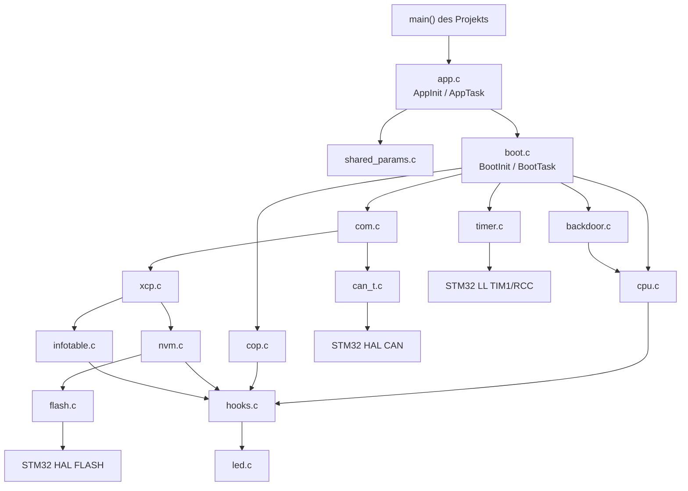
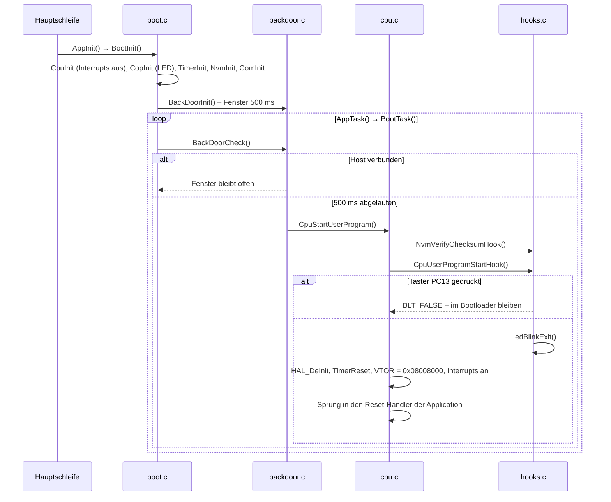
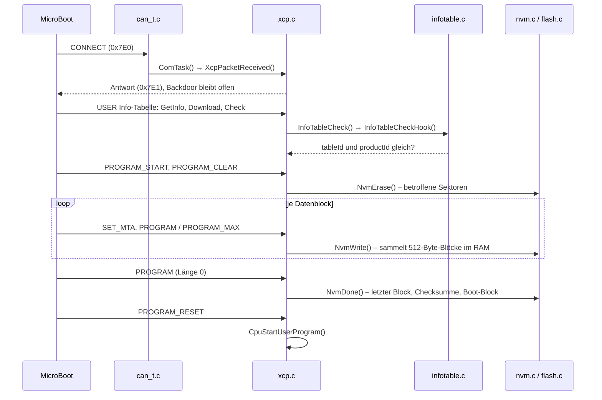

# Architektur STM32F7 MicroBoot

Der Bootloader besteht aus dem OpenBLT-Kern, den STM32F7-Treibern und den Hook-Funktionen
dieses Projekts. Er läuft ohne Interrupts in einer Polling-Schleife, empfängt XCP-Befehle über
CAN3 und schreibt die neue Firmware in den internen Flash. Die Konfiguration steht in
`blt_conf.h`, was davon abweicht, in `hooks.c`.

## Komponenten

| Modul | Datei(en) | Aufgabe |
|-------|-----------|---------|
| Einstieg | `app.c/.h` | Schnittstelle zu `main()`: Shared Parameters und Bootloader initialisieren, Task aufrufen |
| Kern | `boot.c/.h` | Reihenfolge der Initialisierung und des zyklischen Tasks, Version des OpenBLT-Kerns |
| Konfiguration | `blt_conf.h`, `plausibility.h` | Einstellungen und deren Prüfung zur Compile-Zeit |
| Kommunikation | `com.c/.h` | Empfängt Pakete vom aktiven Transportkanal und reicht sie an XCP weiter |
| CAN | `can_t.c/.h` | CAN3 über die HAL, Bittiming aus PCLK1, ein Empfangsfilter auf `0x7E0` |
| Protokoll | `xcp.c/.h` | XCP-Slave: Verbindung, Löschen, Programmieren, Info-Tabelle, Start der Application |
| Backdoor | `backdoor.c/.h` | Hält den Bootloader nach einem Reset 500 ms offen |
| Speicher | `nvm.c/.h`, `flash.c/.h` | Flash-Aufteilung, Blockpuffer, Löschen und Programmieren, Checksumme |
| Info-Tabelle | `infotable.c/.h` | Sammelt die Info-Tabelle der neuen Firmware im RAM und lässt sie prüfen |
| CPU | `cpu.c/.h` | Interrupts sperren, HAL und Timer zurücksetzen, Sprung in die Application |
| Watchdog | `cop.c/.h` | Ruft die Watchdog-Hooks auf, hier nur für die LED genutzt |
| Timer | `timer.c/.h` | Millisekunden-Zeitbasis aus dem freilaufenden TIM1, ersetzt `HAL_GetTick()` |
| Hooks | `hooks.c` | Projektspezifisches Verhalten: Taster, LED, Checksumme, Info-Tabelle, Seed/Key |
| LED | `led.c/.h` | Blinkt `PB7` im 100-ms-Takt |
| Shared Parameters | `shared_params.c/.h` | RAM-Puffer, den Bootloader und Application gemeinsam nutzen |
| Hilfsmodule | `asserts.c/.h`, `types.h` | Assert-Handler, Typdefinitionen |

## Datenfluss

### Start nach einem Reset

Der Taster wird erst am Ende des Backdoor-Fensters abgefragt, nicht beim Reset. Er muss also
mindestens 500 ms nach dem Reset gedrückt bleiben.

### Firmware-Update

Der Boot-Block (erste 512 Byte der Application mit der Vektortabelle) wird erst in `NvmDone()`
geschrieben. Bricht ein Update vorher ab, steht an `0x08008000` gelöschter Flash, und die
Application gilt nur dann als ungültig, wenn die Checksumme tatsächlich geprüft wird.

## Speicher und Ressourcen

### Flash

| Bereich | Adresse | Inhalt |
|---------|---------|--------|
| Sektor 0 | `0x08000000`–`0x08007FFF` | Bootloader (32 kB) |
| Boot-Block | `0x08008000`–`0x080081FF` | Vektortabelle der Application (`0x1F8` Byte), dahinter die Checksumme (4 Byte) |
| Info-Tabelle | `0x08008200`–`0x0800820B` | `tableId`, `productId`, `firmwareVersion` der Application |
| Application | bis `0x081FFFFF` | Sektoren 1–11, zusammen 2016 kB |

Die Aufteilung steht in `flashLayout[]` in `flash.c`. Gelöscht wird immer sektorweise, eine
Firmware von wenigen kB löscht also mindestens Sektor 1 (32 kB).

### RAM

| Puffer | Größe | Zweck |
|--------|-------|-------|
| `blockInfo`, `bootBlockInfo` (`flash.c`) | je 512 Byte + Adresse | Sammeln der Daten bis ein Flash-Block voll ist |
| `infoTableBuffer` (`infotable.c`) | 12 Byte | Info-Tabelle der neuen Firmware |
| `sharedParamsBuffer` (`shared_params.c`) | 64 Byte (Kennung, 56 Datenbytes, Checksumme) | Sektion `.shared`, wird vom Startup-Code nicht initialisiert |

### Peripherie

| Peripherie | Verwendung |
|------------|------------|
| CAN3 | XCP-Kommunikation, 500 kBit/s, Empfang über FIFO0 im Polling |
| TIM1 | freilaufender 16-Bit-Zähler als Millisekunden-Zeitbasis |
| SysTick | wird nicht genutzt, vor dem Sprung in die Application zurückgesetzt |
| `PB7` | LED, Ausgang |
| `PC13` | Taster, Eingang |
| Flash-Controller | Löschen und Programmieren über die HAL |

Pins, Takt und die MSP-Initialisierung von CAN3 kommen aus dem CubeMX-Projekt, in das die
Bibliothek eingebunden ist.

## Nebenläufigkeit

Es gibt keine. `CpuInit()` sperrt alle Interrupts, und alle Module werden aus `BootTask()` in der
Hauptschleife aufgerufen. CAN-Empfang, Timer und Backdoor werden gepollt. Lange Vorgänge wie das
Löschen eines Sektors rufen `CopService()` auf, damit die LED weiterblinkt. `HAL_GetTick()` ist
auf `TimerGet()` umgeleitet, damit HAL-Timeouts ohne SysTick-Interrupt funktionieren.

Erst unmittelbar vor dem Sprung gibt `CpuStartUserProgram()` die Interrupts wieder frei.

## Erweiterung

| Aufgabe | Ansatzpunkt |
|---------|-------------|
| Bootloader-Wunsch aus der Application auswerten | `BOOT_BACKDOOR_HOOKS_ENABLE` auf 1, in `BackDoorEntryHook()` ein Byte aus `SharedParamsReadByIndex()` prüfen |
| Echte Checksumme | `BOOT_NVM_CHECKSUM_HOOKS_ENABLE` auf 0 (Checksumme aus `flash.c`) oder die Hooks in `hooks.c` umsetzen |
| Hardware-Watchdog | IWDG in `CopInitHook()` starten, in `CopServiceHook()` bedienen |
| Anderer Taster oder LED | `CpuUserProgramStartHook()` in `hooks.c`, `led.c` |
| Andere Produktprüfung | `InfoTableCheckHook()` in `hooks.c`, Struktur muss zur Info-Tabelle der Application passen |
| Zugriffsschutz | `BOOT_XCP_SEED_KEY_ENABLE` auf 1, Algorithmus in `XcpGetSeedHook()` / `XcpVerifyKeyHook()` |
